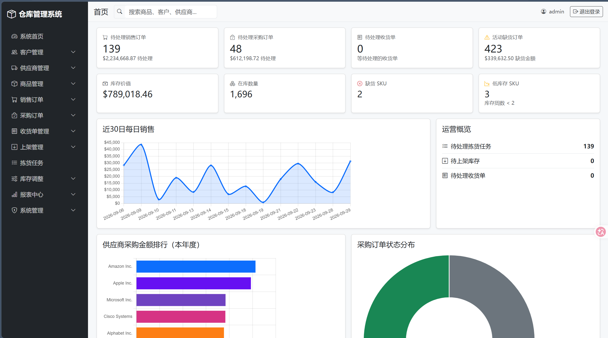
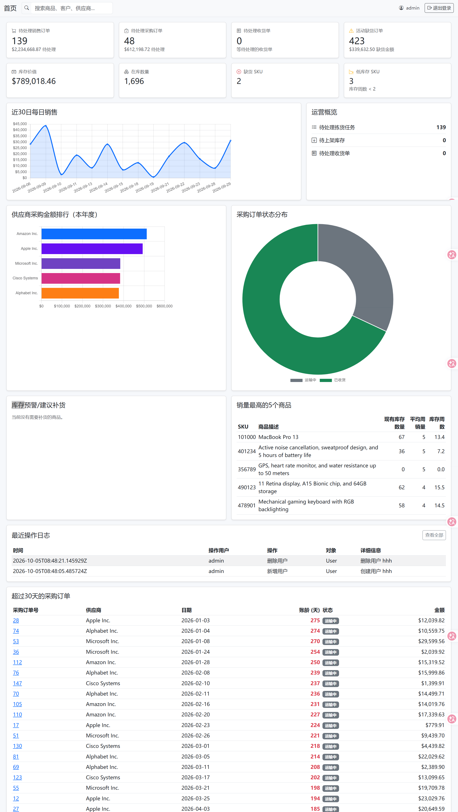
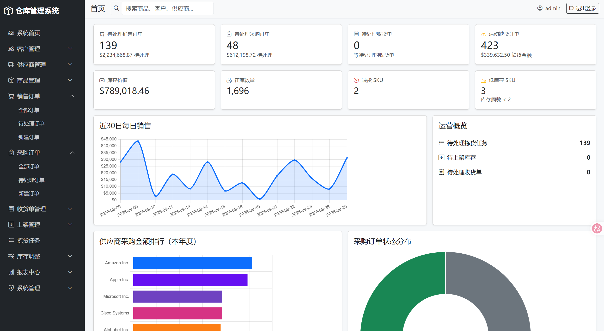
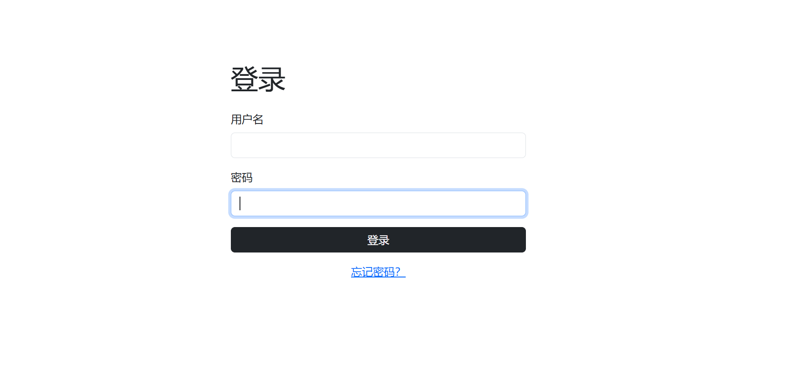
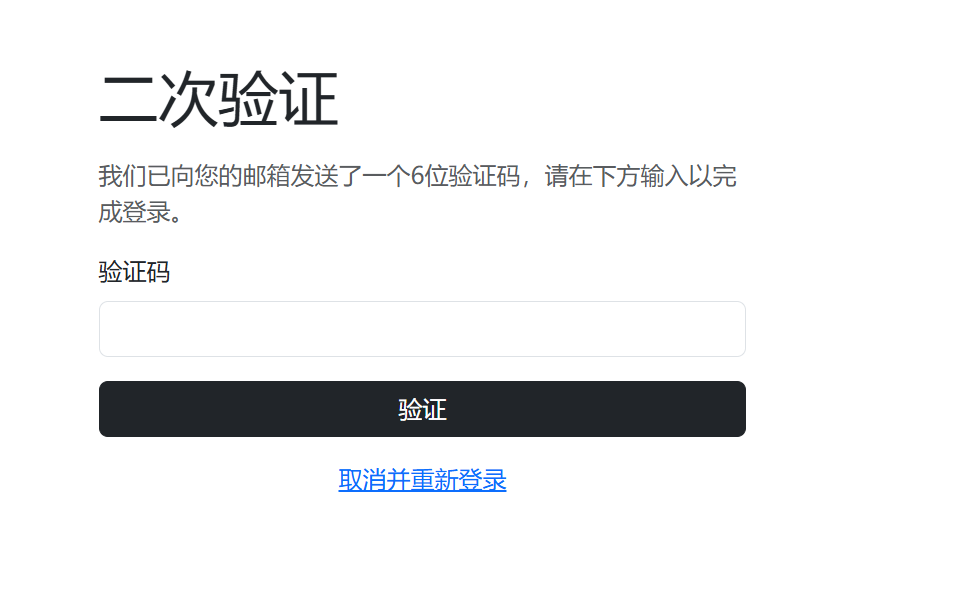
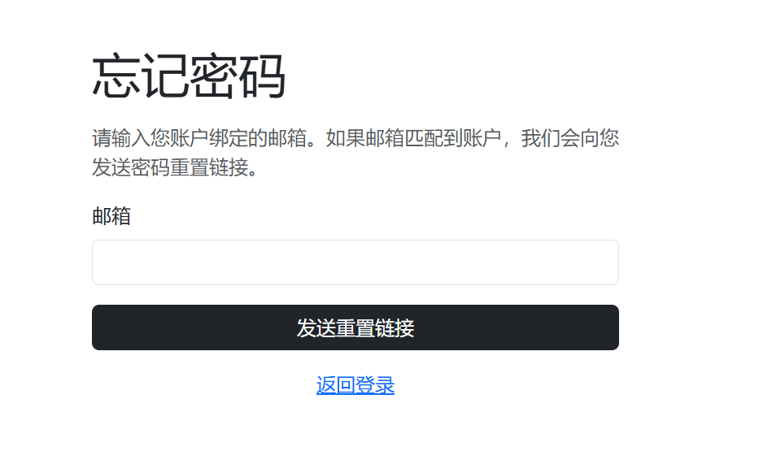
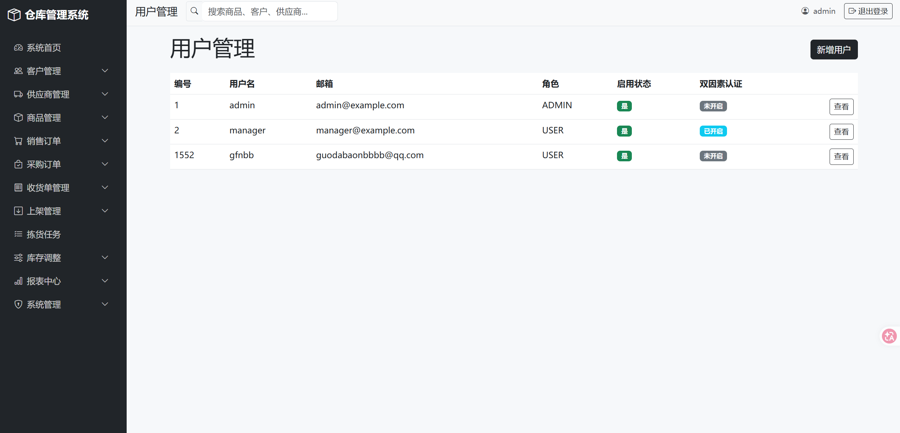

# 仓库管理系统

一个基于 Spring Boot 的企业内部仓库管理 Web 应用，面向中小型企业仓储业务，覆盖商品、客户、供应商、销售订单、采购订单、收货、上架、拣货、库存调整等核心业务流程，并提供身份认证、角色权限控制、运营数据仪表盘、库存预警和操作日志等功能。

> **二次开发说明**
>
> 本项目基于开源项目 `rock-and-code/warehouse-management-system` 进行二次开发与中文化。在保留原项目核心架构、业务逻辑及开源许可的基础上，对系统页面、界面文本和项目文档进行了中文本地化，并补充了用户管理、Dashboard 数据分析、库存预警、操作日志等功能。



---

## 功能特性

### 核心业务

- **商品管理** —— 支持商品信息、新增、编辑、详情及价格管理。
- **客户管理** —— 支持客户信息维护、地址信息及客户详情管理。
- **供应商管理** —— 支持供应商信息维护及供应商详情管理。
- **销售订单** —— 支持销售订单创建、查询、编辑及订单详情查看。
- **采购订单** —— 支持采购订单创建、查询、编辑及订单状态管理。
- **收货管理** —— 支持采购到货登记、收货处理及收货任务管理。
- **上架任务** —— 支持将收货库存分配至指定仓库库位。
- **拣货任务** —— 支持根据销售订单生成并处理库存拣货任务。
- **库存调整** —— 支持库存数量调整及库存业务处理。
- **报表与查询** —— 提供采购、销售及库存相关查询和报表功能。

### 系统管理

- **身份认证** —— 基于 Spring Security 实现登录认证和访问控制。
- **角色权限控制** —— 区分 `ADMIN` 和 `USER` 两种角色。
- **用户管理** —— 管理员可以新增、编辑、删除及启用/禁用系统用户。
- **双因素认证** —— 支持基于邮件验证码的可选双因素认证。
- **密码重置** —— 支持密码重置流程。
- **操作日志** —— 记录管理员新增、修改、删除用户等关键操作，并支持查看最近操作记录。

### Dashboard 数据分析

- **运营数据仪表盘** —— 提供 KPI 数据卡片，包括未完成销售订单、未完成采购订单、待处理收货单、缺货订单等。
- **库存概览** —— 展示库存价值、库存数量、缺货数量及低库存数量。
- **销售趋势** —— 通过 Chart.js 展示每日销售趋势。
- **供应商采购统计** —— 展示年度供应商采购金额排名。
- **采购订单状态** —— 展示不同状态的采购订单数量。
- **库存预警** —— 根据库存数量及历史销售速度计算库存覆盖周期，并提供需要补货的商品建议。
- **热销商品** —— 展示销量排名靠前的商品。
- **采购订单逾期** —— 展示超过 30 天未完成的采购订单。
- **操作日志概览** —— 在 Dashboard 展示最近操作记录，并支持进入完整操作日志页面。

### 基础数据辅助功能

- **中国省市联动** —— 客户和供应商新增页面支持中国省份及城市联动选择。
- **初始化测试数据** —— 项目启动时提供基础业务测试数据，方便开发和功能验证。

---

## 技术栈

| 技术 | 版本 / 说明 |
|---|---|
| Java | 17 |
| Spring Boot | 3.2 |
| Spring Security | 6 |
| Spring Data JPA | ORM / 数据访问 |
| Thymeleaf | 服务端页面渲染 |
| Bootstrap | 5 |
| Chart.js | 4 |
| H2 | 文件型数据库 |
| Flyway | 数据库版本迁移 |
| Lombok | Java 代码简化 |
| Maven | 项目构建与依赖管理 |

---

## 项目结构

```text
warehouse-management-system/
├── src/
│   ├── main/
│   │   ├── java/
│   │   │   └── com/example/warehouseManagement/
│   │   │       ├── Controllers/
│   │   │       ├── Domains/
│   │   │       ├── Repositories/
│   │   │       ├── Services/
│   │   │       ├── Security/
│   │   │       └── ...
│   │   └── resources/
│   │       ├── templates/
│   │       ├── static/
│   │       ├── db/
│   │       │   └── migration/
│   │       └── application.properties
│   └── test/
│       └── java/
├── data/
│   └── warehouse.*
├── pom.xml
├── mvnw
├── mvnw.cmd
└── README.md
```

---

## 运行环境

运行本项目需要：

- JDK 17
- Maven Wrapper
- Git

推荐使用项目自带的 Maven Wrapper，无需单独安装 Maven。

检查 Java 版本：

```bash
java -version
```

应使用 Java 17。

---

## 启动项目

### Windows PowerShell

如果本机安装了多个 JDK，建议先指定 JDK 17：

```powershell
$env:JAVA_HOME="D:\Software\JDK\jdk-17"
$env:Path="$env:JAVA_HOME\bin;$env:Path"
java -version
```

然后启动：

```powershell
.\mvnw.cmd "-Dmaven.test.skip=true" spring-boot:run
```

启动成功后访问：

```text
http://localhost:8080
```

---

## 编译与打包

由于原项目 `src/test/java` 中存在部分既有测试代码的编译问题，本次二次开发未修改原有测试代码及 Maven 测试配置。

因此开发阶段使用 `-Dmaven.test.skip=true` 跳过测试代码的编译和执行。

### 编译

```powershell
.\mvnw.cmd "-Dmaven.test.skip=true" compile
```

### 打包

```powershell
.\mvnw.cmd "-Dmaven.test.skip=true" package
```

> `-Dmaven.test.skip=true` 会跳过测试代码的编译和执行，但不会影响主程序代码的编译。

---

## 默认账户

项目初始化数据中提供开发测试账户。

| 用户名 | 密码 | 角色 |
|---|---|---|
| `admin` | `Password123!` | ADMIN |
| `manager` | `Password123!` | USER |

> 默认账户仅用于开发和功能测试，生产环境中应修改默认密码并使用安全的账户配置。

管理员可以通过系统管理页面创建、编辑和删除普通用户。

普通用户登录后只能访问授权的业务功能，无法访问系统管理功能。

---

## 系统权限

系统目前使用两个角色：

### ADMIN

管理员可以：

- 登录系统
- 查看 Dashboard
- 管理商品、客户、供应商
- 处理采购及销售业务
- 查看库存及报表
- 管理系统用户
- 新增用户
- 编辑用户
- 删除用户
- 设置用户角色
- 启用或禁用用户
- 查看操作日志

### USER

普通用户可以：

- 登录系统
- 使用授权的仓库业务功能
- 处理日常采购、收货、上架、销售、拣货等业务

普通用户不能访问管理员专属的系统管理功能。

---

## 数据库

项目使用文件型 H2 数据库。

数据库连接配置：

```properties
spring.datasource.url=jdbc:h2:file:./data/warehouse;AUTO_SERVER=TRUE
spring.datasource.username=sa
spring.datasource.password=
```

数据库文件默认保存在：

```text
./data/warehouse.*
```

与内存数据库不同，应用重启后数据库中的业务数据不会自动清空。

### Flyway 数据库迁移

项目使用 Flyway 管理数据库结构。

迁移脚本位于：

```text
src/main/resources/db/migration/
```

数据库结构由 Flyway 负责版本化迁移。

Hibernate 配置为：

```properties
spring.jpa.hibernate.ddl-auto=validate
```

因此 Hibernate 主要负责校验 Java Entity 与数据库结构是否匹配，不负责自动创建或修改数据库表结构。

---

## H2 Console

项目开启了 H2 Console：

```text
http://localhost:8080/h2-console
```

连接信息：

| 配置项 | 值 |
|---|---|
| JDBC URL | `jdbc:h2:file:./data/warehouse` |
| User Name | `sa` |
| Password | 留空 |

> H2 Console 主要用于开发和调试，不建议在生产环境中开启。

---

## 邮件配置

系统中的双因素认证和密码重置功能支持邮件发送。

邮件配置通过环境变量读取：

```properties
spring.mail.host=${MAIL_HOST:smtp.example.com}
spring.mail.port=${MAIL_PORT:587}
spring.mail.username=${MAIL_USERNAME:}
spring.mail.password=${MAIL_PASSWORD:}
```

同时支持以下环境变量：

- `MAIL_HOST`
- `MAIL_PORT`
- `MAIL_USERNAME`
- `MAIL_PASSWORD`
- `MAIL_FROM`
- `APP_BASE_URL`

例如：

```text
MAIL_HOST=smtp.gmail.com
MAIL_PORT=587
MAIL_USERNAME=your-email@gmail.com
MAIL_PASSWORD=your-app-password
MAIL_FROM=your-email@gmail.com
APP_BASE_URL=http://localhost:8080
```

使用 Gmail 等邮件服务时，应使用服务商提供的应用专用密码，而不是直接使用账户登录密码。

如果未配置真实 SMTP 信息，开发环境下邮件服务可以将邮件内容输出到控制台，方便本地测试。

> 邮箱账号、密码等敏感信息不要直接提交到 Git 仓库。

---

## 核心业务流程

### 采购入库流程

```text
供应商
  ↓
采购订单
  ↓
收货
  ↓
库存增加
  ↓
上架任务
  ↓
指定仓库库位
```

### 销售出库流程

```text
客户
  ↓
销售订单
  ↓
拣货任务
  ↓
库存扣减
  ↓
销售出库
```

### 库存管理流程

```text
采购 / 收货
      ↓
   库存增加
      ↓
   库存管理
      ↓
库存调整 / 上架
      ↓
   销售 / 拣货
      ↓
   库存减少
      ↓
库存预警 / 补货建议
```

---

## 库存预警

系统基于历史销售数据计算商品的销售速度和库存覆盖周期。

Dashboard 会展示库存预警及补货建议。

主要参考指标包括：

- 当前库存数量
- 历史销售数量
- 周销售速度
- 当前库存可覆盖周数
- 是否存在进行中的采购订单

对于库存覆盖周期较低且没有有效采购订单的商品，系统会将其列入补货建议列表。

Dashboard 默认展示需要优先关注的商品。

---

## 操作日志

系统提供管理员操作日志功能，用于记录关键用户管理操作。

目前记录的操作包括：

- 新增用户
- 修改用户
- 删除用户

日志包含：

| 字段 | 说明 |
|---|---|
| 时间 | 操作发生时间 |
| 操作用户 | 执行操作的用户 |
| 操作 | 操作类型 |
| 对象 | 被操作对象 |
| 详细信息 | 操作具体内容 |

系统会在 Dashboard 展示最近操作日志，同时提供完整的操作日志页面。

完整日志页面：

```text
/admin/operation-logs
```

---

## 中文化与二次开发

本项目基于开源仓库管理系统进行二次开发与中文化。

目前主要完成：

- 系统页面及界面文本中文本地化
- 登录、忘记密码、密码重置、双因素认证等认证页面中文化
- 商品、客户、供应商等基础资料页面中文化
- 销售订单、采购订单、收货、上架、拣货等业务页面中文化
- 库存调整、报表、查询及异常页面中文化
- 客户及供应商新增页面的中国省市联动选择
- 管理员用户管理，包括用户新增、编辑、删除、角色及启用状态管理
- 基于角色的系统访问权限控制
- Dashboard 运营数据统计与可视化
- 库存预警与补货建议
- 用户操作日志记录与查询
- Flyway 数据库迁移脚本完善
- 项目 README 文档中文化及二次开发说明

本次二次开发在保留原项目整体技术架构和核心业务模型的基础上进行功能完善，未对原项目进行整体架构重构。

---

## 项目特点

本项目主要围绕企业内部仓库管理场景进行开发，覆盖从基础资料维护到采购入库、销售出库和库存管理的完整业务链路。

项目重点体现：

- Spring Boot Web 应用开发
- Spring Security 身份认证与权限控制
- Spring Data JPA 数据访问
- Thymeleaf 服务端页面开发
- H2 + Flyway 数据库管理
- Dashboard 数据统计与可视化
- 库存预警与补货逻辑
- 用户操作日志
- 多业务模块协同
- 企业内部系统权限设计
- 中文化及二次开发实践

---

## 常用命令

### 启动

Linux / macOS：

```bash
./mvnw spring-boot:run
```

Windows PowerShell：

```powershell
.\mvnw.cmd "-Dmaven.test.skip=true" spring-boot:run
```

### 编译

Linux / macOS：

```bash
./mvnw "-Dmaven.test.skip=true" compile
```

Windows PowerShell：

```powershell
.\mvnw.cmd "-Dmaven.test.skip=true" compile
```

### 打包

Linux / macOS：

```bash
./mvnw "-Dmaven.test.skip=true" package
```

Windows PowerShell：

```powershell
.\mvnw.cmd "-Dmaven.test.skip=true" package
```

### 检查 Git 工作区

```bash
git status
```

### 检查代码空白错误

```bash
git diff --check
```

---

## 开发说明

### Java 版本

项目使用 Java 17。

如果本机存在多个 JDK，请确保 Maven 和 Spring Boot 使用 Java 17。

### 数据库

项目使用文件型 H2 数据库：

```text
./data/warehouse.*
```

数据库结构由 Flyway 管理。

### Hibernate

项目使用：

```properties
spring.jpa.hibernate.ddl-auto=validate
```

Hibernate 不负责自动创建数据库表。

### H2 SQL

项目部分 Repository 查询使用 H2 数据库相关 SQL 函数，因此数据库环境应与项目默认 H2 配置保持一致。

---

## 系统截图

### 系统首页

登录后进入系统首页。页面顶部展示 KPI 数据，中间展示库存概览、近 30 天每日销售趋势、供应商采购金额、采购订单状态等图表，同时提供库存预警、补货建议、热销商品、采购订单逾期信息和最近操作日志。



### 侧边栏导航

各业务模块通过侧边栏进行分类，并可以展开查看具体功能。顶部导航栏显示当前页面标题和当前登录用户。



### 登录

系统通过 `/login` 提供表单登录功能，同时提供忘记密码入口，可发送密码重置邮件。



### 双因素认证

启用 2FA 的用户在正确输入密码后会进入 `/verify-2fa` 页面。

系统会生成 6 位验证码，并使用 BCrypt 对验证码进行哈希处理后发送邮件。如果没有配置 SMTP，验证码会作为开发环境备用方案输出到应用控制台。



### 忘记密码

无论输入的邮箱是否对应系统账户，页面都会显示相同的提示信息，从而避免通过页面反馈判断账户是否存在。



### 管理员用户管理

管理员可以通过 `/admin/users` 管理系统用户，包括用户列表、新增、编辑、启用/禁用、切换 2FA 和删除用户等操作。

该功能仅允许 `ROLE_ADMIN` 用户访问。



---

## 项目来源

本项目基于开源项目：

`rock-and-code/warehouse-management-system`

原项目主要用于仓库管理业务系统的学习和开发。

本项目在原项目基础上进行中文化和功能二次开发，并保留原项目的相关版权及许可证信息。

原项目地址：

https://github.com/rock-and-code/warehouse-management-system

---

## License

本项目遵循 **MIT License**。

本项目是在原开源项目基础上的二次开发与中文化版本，请保留原项目作者及许可证信息。

原项目：

https://github.com/rock-and-code/warehouse-management-system
